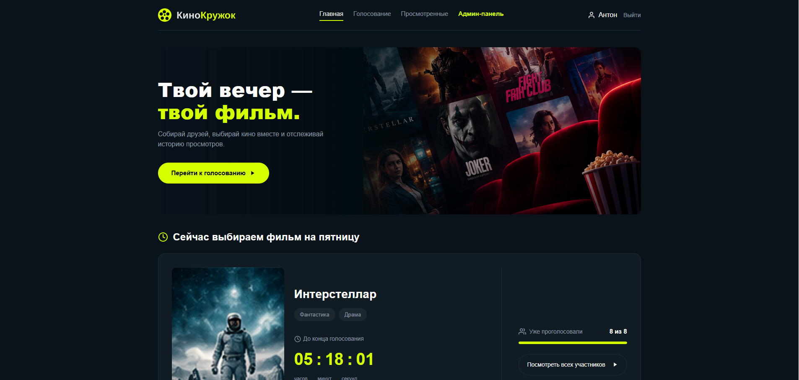
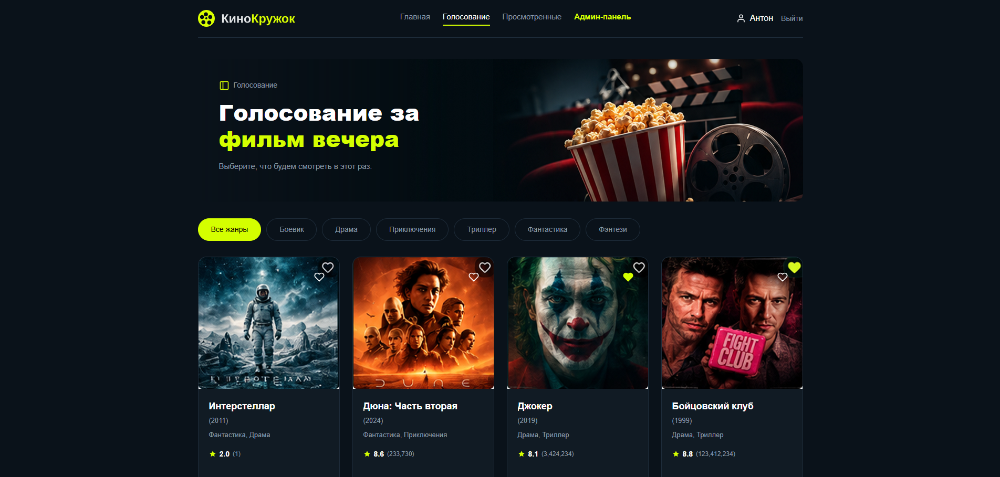
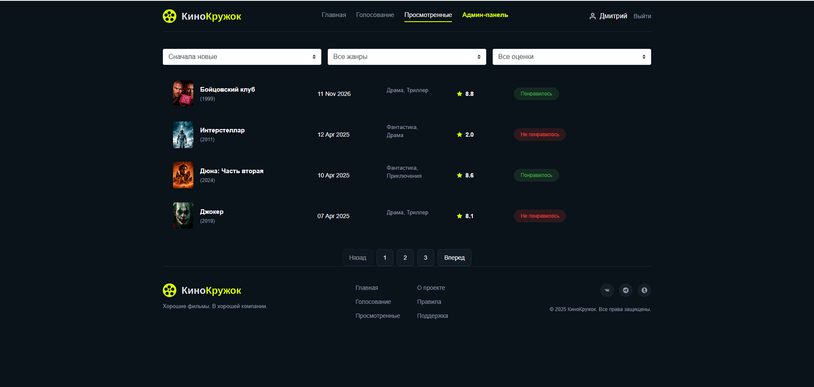

## 📖 О проекте

**«КиноКружок»** — это полноценное веб-приложение, разработанное на фреймворке **Yii2**, представляющее собой платформу для совместного выбора фильмов на вечер. Проект демонстрирует навыки разработки full-stack приложений с использованием MVC-архитектуры, реляционных баз данных и безопасной обработки пользовательских данных. 

В основе приложения лежит идея геймификации: пользователи голосуют за фильмы, ведут историю просмотров и получают персональную аналитику своих вкусов.

## ✨ Ключевой функционал

### 🔐 Аутентификация и Безопасность
* **Кастомная система входа и регистрации:** Реализована через `IdentityInterface` и формы `LoginForm` / `SignupForm`.
* **Role-Based Access Control (RBAC):** Гибкая настройка прав через `AccessControl`. Разделение на гостей (только просмотр), авторизованных пользователей (голосование, избранное) и администраторов (управление контентом).
* **Защита от уязвимостей:** Все POST-запросы (включая удаление и голосование) защищены CSRF-токенами. Вывод данных экранируется через `Html::encode()` для предотвращения XSS-атак.

### 🗳 Система голосования
* **Single-Choice Voting (Один голос):** Умная логика, при которой пользователь может голосовать только за один фильм. При выборе нового фильма предыдущий голос автоматически аннулируется (запись в БД обновляется, а не дублируется).
* **Счетчики реального времени:** Использование `updateAllCounters()` для атомарного обновления рейтинга фильма без блокировок таблиц БД.
* **Умный UI:** Кнопка голосования динамически меняет состояние («Голосовать» / «Ваш голос учтен» / «Изменить голос»). 

### 📊 История и Аналитика профиля
* **Сложные SQL-запросы:** История просмотров и избранное реализованы через `JOIN` таблиц с возможностью фильтрации по жанрам, статусу («Понравилось/Не понравилось») и сортировкой (по дате, по рейтингу).
* **Динамическая аналитика:** В профиле пользователя автоматически вычисляются **любимые жанры** на основе `GROUP BY` и подсчета частоты просмотренных фильмов.
* **UX/UI:** Кастомные Flash-уведомления с плавной анимацией и авто-скрытием через Vanilla JS.

### 🛠 Административная панель
* **Полный CRUD:** Управление фильмами (создание, чтение, обновление, удаление) сгенерировано через **Gii** и кастомизировано под общий дизайн сайта.
* **Безопасное удаление:** Удаление записей из БД защищено POST-запросами и модальными окнами подтверждения.

## 🏗 Архитектура и технические решения

* **Паттерн MVC:** Четкое разделение логики (Controllers), работы с БД (Models, ActiveRecord) и представления (Views).
* **Нормализация БД (3NF):** Вместо хранения строковых жанров в таблице фильмов, создана связь **Many-to-Many** через промежуточную таблицу `movie_genre`, а также отдельная сущность `genre`.
* **Оптимизация запросов:** Использование `ActiveDataProvider` для пагинации списков и `asArray()` в тяжелых запросах с JOIN для снижения нагрузки на память.
* **Отказ от стандартных шаблонов:** Вёрстка полностью кастомная (Flexbox/Grid, CSS-переменные), без использования тяжелых CSS-фреймворков, что обеспечивает высокую скорость загрузки и уникальный дизайн (Dark Theme).
* **Кастомные виджеты:** Вывод списков реализован через `ListView` с переопределением `layout` и `options` для точного соответствия макету.

## 🗄 Схема базы данных
Проект использует реляционную базу данных MySQL. Ключевые таблицы:
* `user` — аккаунты пользователей (с ролями).
* `movie` — каталог фильмов (включая поля для постеров и рейтингов).
* `genre` + `movie_genre` — реализация связи «Многие ко многим».
* `vote` — таблица отданных голосов (строгая связь user_id -> movie_id).
* `user_movie` — история просмотров с датами и лайками.
* `favorite` — избранные фильмы.
* `mood` — динамические категории фильмов на главной странице.

## Скриншоты

